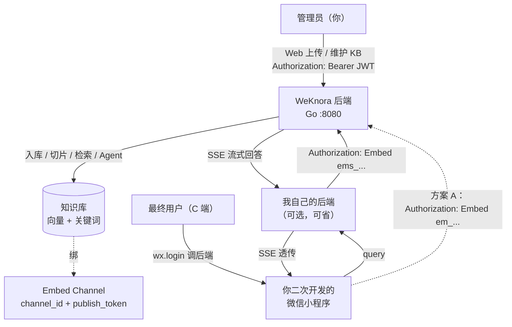
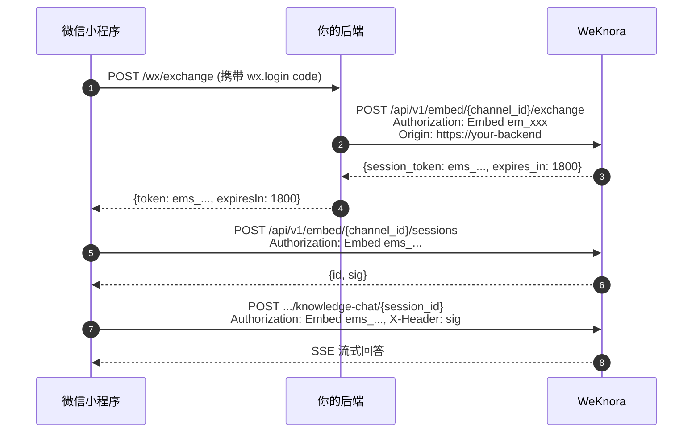
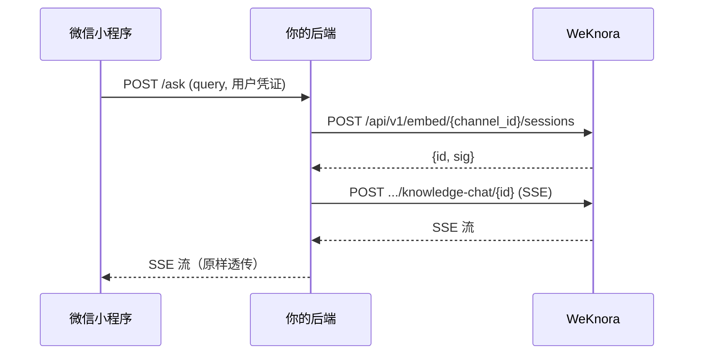

# 基于知识库对外提供应用服务实施指南

本文档面向「自己上传文档搭建知识库，再二次开发一个对外应用（典型为微信小程序）为最终用户提供问答服务」的开发者。它把上一功能《[网页嵌入](../03-features/13-embed-channel.md)》扩展到小程序、移动 App、企业内部系统等任意客户端，给出端到端的实施路径、API 调用方式、安全要点与可复用的小程序代码骨架。

读完本文，你可以：

1. 知道管理员侧要做什么（多数不需要写代码，仅需配置与一次 curl）；
2. 知道小程序侧要改什么、怎么调通 SSE 流式对话；
3. 在三种「小程序如何拿 token」方案中做出选择（Static / Secure / 完全代理）；
4. 掌握上线前必做的服务端配置（域名、密钥、Nginx、签名等）。

> **核心思路**：WeKnora 把"知识库长什么样、文档谁维护"完全留在 Web 管理端，对外只暴露一组 **Embed Channel（嵌入式渠道）** 接口。访客无需注册 WeKnora 账号，所有数据隔离在渠道之下。

---

## 一、整体架构 {#_1-整体架构}



三种接入路径：

| 路径 | Token 流向 | 适用场景 | 安全级别 |
| --- | --- | --- | --- |
| **A. Static 模式** | 小程序直接写死 `em_` token | 内部小程序、低敏感、demo | ★★ |
| **B. Secure 模式（推荐）** | 业务后端保管 `em_`，小程序拿 `ems_` 短效 token | 面向 C 端、需审计 | ★★★★ |
| **C. 完全代理** | 小程序只调业务后端，业务后端代理 WeKnora | 需要做用户鉴权、内容过滤、敏感词 | ★★★★★ |

---

## 二、管理员侧：建知识库并创建 Embed Channel {#_2-管理员侧-建知识库并创建-embed-channel}

管理员侧的操作 99% 可以通过 Web 管理端完成，需要脚本的场景主要是批量导入。下面是完整的 curl 脚本，可保存为 `bootstrap.sh` 一次性跑完。

### 2.1 一次性脚本 {#_2-1-一次性脚本}

```bash
#!/usr/bin/env bash
# 用法：BASE=... TOKEN=... KB_NAME=... AGENT_NAME=... ./bootstrap.sh
set -euo pipefail

: "${BASE:?请设置 BASE，例如 https://weknora.example.com}"
: "${TOKEN:?请先通过 /api/v1/auth/login 拿到 JWT}"

KB_NAME="${KB_NAME:-产品手册}"
AGENT_NAME="${AGENT_NAME:-客服助手}"
# 该域名是最终用户访问你后端的源站，安全模式或代理模式需要
PUBLIC_ORIGIN="${PUBLIC_ORIGIN:-https://your-backend.example.com}"

# 1) 建知识库
KB_ID=$(curl -fsS "$BASE/api/v1/knowledge-bases" \
  -H "Authorization: Bearer $TOKEN" -H 'Content-Type: application/json' \
  -d "{\"name\":\"$KB_NAME\",\"type\":\"document\"}" | jq -r .data.id)
echo "KB_ID=$KB_ID"

# 2) 上传文档（URL 抓取，可多条）
curl -fsS -X POST "$BASE/api/v1/knowledge-bases/$KB_ID/knowledge/url" \
  -H "Authorization: Bearer $TOKEN" -H 'Content-Type: application/json' \
  -d '{"url":"https://docs.example.com/getting-started","enable_multimodel":false}'

# 2') 或上传文件（multipart）
curl -fsS -X POST "$BASE/api/v1/knowledge-bases/$KB_ID/knowledge/file" \
  -H "Authorization: Bearer $TOKEN" -F file=@./manual.pdf

# 3) 建 Agent 并把 KB 绑进去
AGENT_ID=$(curl -fsS "$BASE/api/v1/agents" \
  -H "Authorization: Bearer $TOKEN" -H 'Content-Type: application/json' \
  -d "{
    \"name\":\"$AGENT_NAME\",
    \"type\":\"quick_answer\",
    \"knowledge_base_ids\":[\"$KB_ID\"]
  }" | jq -r .data.id)
echo "AGENT_ID=$AGENT_ID"

# 4) 创建 Embed Channel
CHANNEL=$(curl -fsS -X POST "$BASE/api/v1/agents/$AGENT_ID/embed-channels" \
  -H "Authorization: Bearer $TOKEN" -H 'Content-Type: application/json' -d "{
    \"name\":\"小程序客服\",
    \"enabled\":true,
    \"allowed_origins\":[\"$PUBLIC_ORIGIN\"],
    \"rate_limit_per_minute\":60,
    \"rate_limit_per_day\":5000,
    \"welcome_message\":\"您好，请问需要什么帮助？\",
    \"page_title\":\"智能助手\",
    \"primary_color\":\"#07C05F\",
    \"show_suggested_questions\":true,
    \"agent_id\":\"$AGENT_ID\"
  }")
CH_ID=$(echo "$CHANNEL" | jq -r .data.id)
EM_TOKEN=$(echo "$CHANNEL" | jq -r .data.publish_token)

echo "============================================"
echo "CH_ID=$CH_ID"
echo "EM_TOKEN=$EM_TOKEN  （em_ 开头，保密！）"
echo "============================================"
echo "把这两个值交给小程序开发者。"
```

字段细节见 [internal/handler/embed_channel.go:62-80](file:///Users/mao/work/opensource/github.com/Tencent/WeKnora/internal/handler/embed_channel.go#L62-L80)；API 文档见 [website-docs/04-api/02-api-channels.md:118-200](file:///Users/mao/work/opensource/github.com/Tencent/WeKnora/website-docs/04-api/02-api-channels.md#L118-L200)。

### 2.2 必做项速查表 {#_2-2-必做项速查表}

| 项 | 怎么做 | 没做会怎样 |
| --- | --- | --- |
| 设置签名密钥 | WeKnora 后端环境变量 `SYSTEM_SIGNING_KEY` = 32 字节 hex | `POST /api/v1/embed/:id/sessions` 直接 503（"embed session signing key is not configured"） |
| Origin 白名单 | `allowed_origins` 填「实际宿主」的源站。Static 模式填小程序访问 WeKnora 的来源；Secure 模式填你后端域名 | 所有访客请求被拒 |
| 公网域名 + HTTPS | 微信小程序强制要求；`localhost` 在真机调试无效 | 真机跑不起来 |
| 上传 `manual.pdf` 的安全合规 | 文件类型与大小限制在 `config.yaml` 的 `storage` / `docreader` 节，按需调整 | 上传过大文件失败 |

签名密钥未配置的报错见 [internal/application/service/embed_session.go:113-115](file:///Users/mao/work/opensource/github.com/Tencent/WeKnora/internal/application/service/embed_session.go#L113-L115)；限流与白名单逻辑见 [internal/middleware/embed_auth.go:81-175](file:///Users/mao/work/opensource/github.com/Tencent/WeKnora/internal/middleware/embed_auth.go#L81-L175)。

---

## 三、三种小程序接入方案 {#_3-三种小程序接入方案}

下面代码示例只展示**关键差异**，完整小程序骨架见 [miniprogram/](file:///Users/mao/work/opensource/github.com/Tencent/WeKnora/miniprogram)。

### 3.1 方案 A：Static 模式（最快） {#_3-1-方案-a-static-模式-最快}

> publish token 编译期写入小程序，**对所有用户可见**。只适合内部工具或 demo。

```javascript
// miniprogram/utils/embed.js
const CONFIG = {
  base: 'https://weknora.example.com',
  channelId: 'ch_xxxxxxxxxxxxxxxxxxxxxxxxxxxx',
  publishToken: 'em_xxxxxxxxxxxxxxxxxxxxxxxxxxxxxxxxxxxxxxxxxxxx'
};

let session = null;          // {id, sig}，本会话内复用
let sessionToken = CONFIG.publishToken;   // Static 模式直接用 publish token

async function createSession() {
  if (session) return session;
  const r = await wx.request({
    url: `${CONFIG.base}/api/v1/embed/${CONFIG.channelId}/sessions`,
    method: 'POST',
    header: { 'Authorization': `Embed ${sessionToken}` }
  });
  if (r.statusCode !== 200) throw new Error(r.data.error?.message || r.statusCode);
  session = r.data.data;     // {id, sig}
  return session;
}

// 流式对话（项目里 utils/sse.js 已提供解析逻辑，可直接复用）
async function chat(query) {
  const { id: sessionId, sig } = await createSession();
  const r = await wx.request({
    url: `${CONFIG.base}/api/v1/embed/${CONFIG.channelId}/knowledge-chat/${sessionId}`,
    method: 'POST',
    header: {
      'Authorization': `Embed ${sessionToken}`,
      'X-Embed-Session': sig,
      'Content-Type': 'application/json'
    },
    data: { query },
    dataType: 'text',       // SSE 流是 text
    responseType: 'text'
  });
  return collectAnswerFromSSE(r.data);   // 复用 miniprogram/utils/sse.js
}

module.exports = { chat, createSession };
```

适用：内部 demo / 一次性活动页面。

### 3.2 方案 B：Secure 模式（推荐） {#_3-2-方案-b-secure-模式-推荐}

> publish token 只在你自己的后端；微信运行时永远拿不到。



#### 3.2.1 你后端的换取端点（Go 示例）

```go
// POST /wx/exchange
//
// 1. 用 wx.login 的 code 换 openid（此处省略）
// 2. 验证该 openid 是否有权访问（按需做用户鉴权、配额、审计）
// 3. 调 WeKnora 换取短效 token
func (h *Handler) WxExchange(w http.ResponseWriter, r *http.Request) {
    // ... 业务鉴权 ...

    origin := r.Header.Get("Origin")     // 必须等于 channel 的 allowed_origins
    req, _ := http.NewRequest("POST",
        h.WeKnoraBase+"/api/v1/embed/"+h.ChannelID+"/exchange", nil)
    req.Header.Set("Authorization", "Embed "+h.PublishToken)
    req.Header.Set("Origin", origin)

    resp, err := http.DefaultClient.Do(req)
    if err != nil { /* 5xx */ return }
    defer resp.Body.Close()

    var payload struct {
        Success bool `json:"success"`
        Data    struct {
            SessionToken string `json:"session_token"`
            ExpiresIn    int    `json:"expires_in"`
        } `json:"data"`
    }
    json.NewDecoder(resp.Body).Decode(&payload)

    json.NewEncoder(w).Encode(map[string]any{
        "token":     payload.Data.SessionToken,
        "expiresIn": payload.Data.ExpiresIn,
    })
}
```

注意：
- **必须**给 WeKnora 转发与渠道白名单一致的 `Origin` 头，否则服务端拒绝；
- 不要把 publish token 写到任何返回给小程序 / 浏览器的字段；
- 安全模式只在业务后端调用 `/exchange`，小程序从不直接调 WeKnora 的 `/exchange`。

#### 3.2.2 小程序侧（替换现有 request.js）

```javascript
// miniprogram/utils/embed.js（方案 B 版本）
const { collectAnswerFromSSE } = require('./sse');    // 复用项目里的 SSE 解析

let memToken = null;       // 内存中的 ems_ token
let memExpiresAt = 0;
let session = null;        // {id, sig}

async function fetchEmbedToken() {
  if (memToken && Date.now() < memExpiresAt - 30_000) return memToken;
  const r = await wx.request({
    url: 'https://your-backend.example.com/wx/exchange',
    method: 'POST',
    header: { 'Content-Type': 'application/json' }
  });
  memToken = r.data.token;
  memExpiresAt = Date.now() + r.data.expiresIn * 1000;
  return memToken;
}

async function createSession() {
  if (session) return session;
  const tok = await fetchEmbedToken();
  const r = await wx.request({
    url: 'https://weknora.example.com/api/v1/embed/<channel_id>/sessions',
    method: 'POST',
    header: { 'Authorization': `Embed ${tok}` }
  });
  session = r.data.data;
  return session;
}

async function chat(query) {
  const tok = await fetchEmbedToken();
  const { id, sig } = await createSession();
  const r = await wx.request({
    url: `https://weknora.example.com/api/v1/embed/<channel_id>/knowledge-chat/${id}`,
    method: 'POST',
    header: {
      'Authorization': `Embed ${tok}`,
      'X-Embed-Session': sig,
      'Content-Type': 'application/json'
    },
    data: { query },
    dataType: 'text',
    responseType: 'text'
  });
  return collectAnswerFromSSE(r.data);
}
module.exports = { chat };
```

`ems_` token 30 分钟过期，前端在 80% TTL 处自动刷新；服务端不需要主动推送。

### 3.3 方案 C：完全代理（最稳） {#_3-3-方案-c-完全代理-最稳}



你后端做的事：

1. 鉴权小程序用户（按业务需要，可对接你已有的用户体系）；
2. 调 WeKnora embed 接口拼出 SSE 流；
3. 把 SSE 流原样转回小程序，可在中途做敏感词过滤、用户级限流、审计日志。

参考实现：复用方案 B 3.2.1 的 Go handler，把 `/wx/exchange` 改成 `/wx/ask`，自己再代理一次会话 + 对话。

---

## 四、小程序侧最小改造清单 {#_4-小程序侧最小改造清单}

仓库自带小程序 [miniprogram/](file:///Users/mao/work/opensource/github.com/Tencent/WeKnora/miniprogram) 默认使用 **租户 API Key**（[utils/request.js:18-22](file:///Users/mao/work/opensource/github.com/Tencent/WeKnora/miniprogram/utils/request.js#L18-L22)），所有用户共享一个身份、能看到所有 KB，**不适合开放给 C 端**。改造建议：

| 文件 | 现状 | 改造 |
| --- | --- | --- |
| `utils/request.js` | `header.X-API-Key` 调 `/api/v1/...` | 替换为 `Authorization: Embed ems_...`，URL 前缀改为 `/api/v1/embed/<channel_id>/...`；新增 `X-Embed-Session` 头 |
| `utils/config.js` | 存 `baseUrl` / `apiKey` | 增加 `channelId`，删除 `apiKey` 字段 |
| `pages/settings/settings.js` | 录入 API Key | 改为录入 channelId（或后端换取端点 URL） |
| `pages/chat/chat.js` `ensureSession` | 调 `POST /api/v1/sessions` | 改为 `POST /api/v1/embed/<channel_id>/sessions` |
| `utils/sse.js` | SSE 解析 | **直接复用**，无需修改 |

> SSE 解析逻辑（[utils/sse.js](file:///Users/mao/work/opensource/github.com/Tencent/WeKnora/miniprogram/utils/sse.js)）与 WeKnora 的 SSE 协议一致，协议细节见 [website-docs/03-features/13-embed-channel.md:91-148](file:///Users/mao/work/opensource/github.com/Tencent/WeKnora/website-docs/03-features/13-embed-channel.md#L91-L148)。前端无需做任何调整。

---

## 五、端到端联调 checklist {#_5-端到端联调-checklist}

按顺序勾选：

- [ ] WeKnora 已部署到公网域名 + HTTPS（小程序要求）
- [ ] 后端环境变量 `SYSTEM_SIGNING_KEY` 已设置（32 字节 hex）
- [ ] 管理员已通过 Web 后台上传文档、绑定 Agent、创建 Embed Channel
- [ ] 渠道 `allowed_origins` 填了你后端域名（Secure 模式）或小程序访问 WeKnora 的来源（Static 模式）
- [ ] 渠道 `rate_limit_per_minute`、`rate_limit_per_day` 调整到预期容量
- [ ] 业务后端 `/wx/exchange` 已上线，Nginx/网关配好 CORS、QPS 上限
- [ ] 小程序 `request 合法域名` 已加入 WeKnora 域名（小程序后台 → 开发管理）
- [ ] 小程序代码改造完成（按 [第四章](#_4-小程序侧最小改造清单)）
- [ ] 真机联调：登录小程序 → 提问 → 收到 SSE 流式回答
- [ ] 后端日志验证：WeKnora 侧 `sessions` 表有 `embed_channel:<channel_id>` 描述的记录
- [ ] 应急演练：`POST /api/v1/embed-channels/:id/rotate-token` 后旧 `ems_` 全部失效

---

## 六、安全要点（必读） {#_6-安全要点-必读}

1. **publish token 等同于管理员权限**：泄露后任何人都能调所有访客接口 + 看 KB / 历史。Static 模式慎用。
2. **必须**配置 `allowed_origins`，**生产禁止 `*`**；WeKnora 服务端强制白名单生效 ([embed_auth.go:128-147](file:///Users/mao/work/opensource/github.com/Tencent/WeKnora/internal/middleware/embed_auth.go#L128-L147))。
3. **三层限流**：单 IP/分钟 + 渠道/分钟 + 渠道/天，超过返回 429；调高前评估后端容量。
4. **会话签名**：每次 `POST /sessions` 返回 `sig`，后续 `/sessions/:id/*` 必须带 `X-Embed-Session: <sig>`，常量时间比较防篡改。
5. **payload 越权防护**：服务端 (`embed_channel.go:687-742` 的 `patchEmbedChatPayload`) 会丢弃请求体里的 `knowledge_base_ids`、`knowledge_ids`、`tag_ids`、`mentioned_items`、`skill_names`、`mcp_service_ids`，最终以渠道绑定的 Agent 为准。
6. **Token 轮换应急**：怀疑泄露立即 `POST /api/v1/embed-channels/:id/rotate-token`，**所有 `ems_` 同时失效**。
7. **iframe 嵌入**（如果走网页版）：配置 Nginx `/embed/:channelId` 走 `auth_request /api/v1/embed-frame-policy`，动态注入 `frame-ancestors` CSP。
8. **审计**：渠道可配 `webhook_url` + `webhook_secret`，每次对话开始/结束会 POST 业务后端（HMAC-SHA256 签名头），事件定义见 [website-docs/03-features/13-embed-channel.md:149-180](file:///Users/mao/work/opensource/github.com/Tencent/WeKnora/website-docs/03-features/13-embed-channel.md#L149-L180)。

---

## 七、常见问题 FAQ {#_7-常见问题-faq}

### Q1. 真机调试时 `request:fail url not in domain List`？

A. 微信小程序后台「开发管理 → 服务器域名」必须添加 WeKnora 域名（如果是 Secure 模式，还要加你后端域名）；开发期可在「开发者工具 → 详情 → 不校验合法域名」临时跳过，但生产必须配。

### Q2. 浏览器能调通，到小程序就报 403 / Origin 不对？

A. 浏览器自动带 `Origin` 头，小程序 `wx.request` **也带**，但请确认后端 `allowed_origins` 写的是带 `https://` 的完整源站（不要带尾部 `/`）。

### Q3. 后端报 "embed session signing key is not configured"？

A. 设置环境变量 `SYSTEM_SIGNING_KEY`（32 字节 hex）。参考 [第二章 2.2](#_2-2-必做项速查表)。

### Q4. 多用户并发时为什么访问别人的会话失败？

A. 每次 `POST /sessions` 返回的 `sig` 绑定了 `channel_id + session_id`，必须**每个用户各自创建自己的 session**，不能复用。`X-Embed-Session` 头缺失或错值都会 401/403。

### Q5. SSE 在小程序里流式断开？

A. 微信小程序 `wx.request` 默认是缓冲完一次性返回。把 `responseType` 设 `'text'`、`enableChunked: true`（微信基础库 ≥ 2.27.1），并参考 [utils/sse.js](file:///Users/mao/work/opensource/github.com/Tencent/WeKnora/miniprogram/utils/sse.js) 做行/段解析。

### Q6. 想换一个 KB 用同一个小程序怎么办？

A. 渠道绑的是 Agent 不是 KB；换 KB 的最简方式：

```bash
# 更新 Agent 把 KB 列表改了
curl -X PUT "$BASE/api/v1/agents/$AGENT_ID" \
  -H "Authorization: Bearer $TOKEN" -H 'Content-Type: application/json' \
  -d "{\"knowledge_base_ids\":[\"$NEW_KB_ID\"]}"
```

渠道本身不动；所有访客的 `ems_` 不受影响。

### Q7. 没有后端，能不能纯前端搞定？

A. 可以走方案 A（Static 模式），但 `em_` token 暴露在前端代码里，可以被任何人扒走调任意 embed 接口。**仅限 demo / 内部**。

### Q8. 能不能像 WeKnora 自带小程序那样直接拿租户 API Key？

A. 不推荐。自带小程序（[miniprogram/](file:///Users/mao/work/opensource/github.com/Tencent/WeKnora/miniprogram)）用的是租户 API Key + `X-API-Key`，调用的是 `/api/v1/...` 而非 `/api/v1/embed/...`。这种方式下**所有访客共享同一身份**，看到的 KB / 历史是租户的，不是访问 APP 用户的；不适合作为「对外开放的应用服务」。

---

## 八、相关源码与文档索引 {#_8-相关源码与文档索引}

源码：

- [internal/handler/embed_channel.go](file:///Users/mao/work/opensource/github.com/Tencent/WeKnora/internal/handler/embed_channel.go) — 渠道 CRUD + 公开 chat 端点 + payload 防护
- [internal/middleware/embed_auth.go](file:///Users/mao/work/opensource/github.com/Tencent/WeKnora/internal/middleware/embed_auth.go) — Embed 鉴权、Origin 白名单、三层限流
- [internal/application/service/embed_session.go](file:///Users/mao/work/opensource/github.com/Tencent/WeKnora/internal/application/service/embed_session.go) — `ems_` token 发放、HMAC 签名
- [internal/application/service/embed_webhook.go](file:///Users/mao/work/opensource/github.com/Tencent/WeKnora/internal/application/service/embed_webhook.go) — 访客事件回调
- [internal/types/embed_channel.go](file:///Users/mao/work/opensource/github.com/Tencent/WeKnora/internal/types/embed_channel.go) — 渠道结构体定义

文档：

- [网页嵌入](../03-features/13-embed-channel.md) — 功能总览、时序图、iframe 接入、Webhook、安全模式
- [API 参考 - Channels](../04-api/02-api-channels.md) — 每个端点的请求/响应 + curl
- [微信小程序客户端](../05-clients/04-miniprogram.md) — 项目自带小程序的使用说明（注意：它是 API Key 模式）
- [代码阅读指南总览](06-code-reading-overview.md) — 二次开发时的源码阅读路径
- [扩展点指南](03-extension-points.md) — 想自定义存储、检索、解析、Agent 工具时的接入点

操作脚本：本章 [2.1 bootstrap.sh](#_2-1-一次性脚本)。